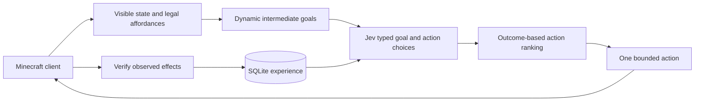

# Jev Minecraft

A first prototype of an autonomous Minecraft Java player using **local OpenJev** for typed decisions, with persistent outcome learning around the model. No API key or paid inference is required. TypeSafe's hosted Jev remains an explicitly selected optional provider. The objective is eventual independent survival-to-dragon play. This version has verified wood collection, planks/sticks crafting, crafting-table placement, wooden-pickaxe crafting, cobblestone collection, stone-pickaxe/stone-sword crafting, and completing a compact house with a door in live play. It has **not** demonstrated reliable survival, live bed construction, full-game completion, or learned improvement across matched worlds.

## Controller v6: new skills and current limits

This is still a prototype, not a demonstrated human-level Minecraft policy. OpenJev ranks available choices with frozen model weights. Outcome statistics change action preferences, and the world map now remembers visited terrain and actual harm across sessions; neither mechanism trains new motor skills or supplies missing gameplay abilities. V6 adds furnace cooking/smelting, fuel selection, iron-tool prerequisites, armor and shield equipment, torch placement, and crop tilling, planting, fertilizing, harvesting and replanting. Portal construction, stronghold discovery and dragon combat remain unimplemented. A larger model or a stronger prompt alone cannot execute actions absent from the adapter.

The longer v4 development run exposed four deaths and 472 low-oxygen interruptions. Mineflayer reports breath on a 0–20 scale; the old 150 threshold treated ordinary swimming as an emergency. V5 triggers low-air recovery at 8 or less, scans after spawning, tracks visible moving targets, and searches for food before starvation. It recognizes ripe berries as a harvestable food source and recovers useful observed dropped equipment. Ordinary travel conserves hunger when food reserves are absent, while escape can sprint if hunger permits. Damage-type registry packets distinguish verified starvation damage from attacks so obtaining food is not repeatedly cancelled. Pursuits with no hits or relevant drops for 40 seconds are abandoned for one minute, with the failed pursuit recorded as negative experience. Entities are considered only inside the field of view with line of sight; loaded hidden entities are not automatically known.

The exploration skill persists four-block ground cells in SQLite, migrates positions from historical gameplay, holds a travel bearing, avoids recent destination reversals and failed steps, and can clear reachable leaf obstructions. It searches actual observed ground rather than tree crowns. Actual damage and death locations add a temporary route cost that gradually decays; this remembers risk without asserting that unseen enemies are still present. Walk distance, displacement, newly visited ground and survey turns are recorded. Life duration now observes death events even during reactive control; older life-duration metrics can overstate survival and are not comparable. Controller/reward revisions are separated in reports.

Regression checks and live traces are saved in `data/controller-v5-tests.log` and `data/controller-v5-live-current.log`; `data/controller-v5-validation.json` records the development evidence and remaining failures. These single-world debugging sessions do not demonstrate learned improvement across matched worlds or parity with a human player.

V6 uses 70 furnace recipes extracted from the installed vanilla 1.21.1 server JAR, including expanded item tags; these describe mechanics, not hidden world resources. Farming checks observed water, actual crop age and harvested drops. Station and crop memories are isolated by world and dimension and labeled as past observations. Crafting reconciles the server inventory after container use, reclaims cursor/grid ingredients, and rejects unexpected material loss. Unloaded house chunks preserve the last survey. A stalled work task is deferred after eight actions without productive results, so successful camera turns cannot count as ongoing task progress.

Run `npm test` for regression checks and `npm run skills:smoke` for real adapter verification. The latter starts a **separate** temporary survival server on port 25566, supplies fixture ingredients, disables fixture mobs and accelerates fixture crops with bone meal. It verifies furnace smelting/cooking, subsequent crafting, equipment and farming through actual inventory/block changes, then shuts down and saves a receipt in `data/skill-fixtures/`. This is skill verification, not an autonomous benchmark, learned discovery of those skills, or evidence of human-level play. Main-world development traces are in `data/controller-v6-live-final.log`; evidence and limits are summarized in `data/controller-v6-validation.json`. Model weights remain frozen; persistent strategy values adapt from measured action outcomes.

## Free local decisions

The local engine is [mjdileep/OpenJev](https://github.com/mjdileep/OpenJev), pinned to commit `501da7e6b59c71e1d184a0eb37e36f8cc5bc6354`. It runs `mlx-community/Qwen3.5-2B-4bit` on this Mac's Apple Silicon using MLX, pinned to model revision `674aaa7240b91e8012fcad5d791b7dfe5ba90207`. It scores supplied candidates without generating gameplay instructions. This independent project does not contain TypeSafe's proprietary Jev weights or RLCD implementation.

Your suggested [awesome-jev-tools directory](https://github.com/v-modal/awesome-jev-tools) was used to review local decision engines and gameplay patterns. It is a directory of separate projects, not an installable Minecraft agent or model. Local runtime selection was checked against the implementation's own code and a real inference test rather than assuming the directory certifies performance.

The model and Python environment are already installed. Start the two local services, then the agent:

```sh
npm run server:start
npm run openjev:start
npm run doctor
npm start
```

`npm start` starts any stopped local services, opens an isolated Minecraft **1.21.1** window with a small client-only spectator HUD, joins the local world as the invisible spectator **JevViewer**, and attaches that camera to **Jev**. The viewer is a passive camera with movement, attack, use, inventory, hotbar and detach controls disabled. The model's player remains in survival mode. You see its movement and camera in Minecraft, plus its actual nine hotbar slots, selected slot, health, hunger, and current activity. The HUD reads an atomic local state file every 100 ms; it shows offline/reconnecting when data is stale. It never mirrors items into your spectator inventory or gives you control of the AI. Decisions and measured outcomes also appear in the terminal. A running viewer window is reused. Ctrl+C stops the agent and camera supervisor; the viewer and server stay open. When Jev is offline, the window remains an idle spectator view.

For terminal-only play use `npm run start:headless`, or set `JEV_VIEWER=false`. To reopen just the Minecraft window use `npm run viewer:open`. If you manually disconnect the viewer from the server, close that window before starting again so it reconnects automatically.

The viewer uses a separate Fabric installation (loader 0.16.14, Minecraft 1.21.1, only the local HUD mod) in `data/viewer/`, its own settings and logs, and a local test identity accepted only by this development server. It does not read your launcher accounts or change existing Minecraft profiles/modpacks. Existing immutable assets and libraries are reused via hard links; runtime caches are privately copied, and missing client files are downloaded from Mojang. The launch helper is `minecraft-launcher-lib==8.0`. To repair missing vanilla client files run `npm run viewer:install`; Fabric is installed on launch. To rebuild the HUD with JDK 21+ run `npm run viewer:build` (the pinned Gradle 9.2.1 wrapper). The mod is in `viewer-hud/`; it changes only spectator rendering. Close the isolated viewer before reopening after a mod update. Client output is in `data/viewer-console.log`.

Camera setup uses a password-protected server console bound to **127.0.0.1:25575**. The password stays in the ignored, owner-readable `server/server.properties`; it is never sent to the model. A small installed server data pack enforces spectator mode for `JevViewer` and follows the agent every tick, so camera restrictions survive launcher interruptions and reconnects. Saved player modes are preserved on login; the viewer reconnects as a spectator while Jev remains a survival player. These rules give no operator privileges, items, teleport controls or spectator mode to the AI. This camera supervision is outside the gameplay decision policy.

Both services are running after setup. To stop the model service use `npm run openjev:stop`; the Minecraft server has its own `server:stop` command. OpenJev listens only on `127.0.0.1:8767`. Its launcher enables `HF_HUB_OFFLINE=1`, so inference uses downloaded weights. The Node adapter refuses remote OpenJev addresses and never falls back to a paid provider. Logs are in `data/openjev.log`.

Controller v4 holds a navigation destination for up to eight seconds with continuous position and threat checks, retries a stalled route once using restricted terrain recovery, and cools down unreachable targets. Combat approaches a lone manageable melee enemy when armed, uses weapon cooldowns, and defends when an enemy catches up during retreat. Daylight neutral spiders alone no longer trigger escape. A distant or blocked workbench can be replaced locally; house completion approaches the actual doorway. Food reserves and surface searches for sheep are explicit objectives. These changes are regression tested; they do not establish human-level play or reliable full-run survival. Current test output and live development traces are in `data/controller-v4-tests.log` and `data/controller-v4-live-final.log`.

Earlier development receipts are summarized in `data/controller-v3-validation.json` (54 passing unit tests, separate from real gameplay evidence). The verified tool progression spans development sessions in the same survival world; it is not a clean-world speedrun or proof of learned improvement.

The original controller was mostly idle: 46 of its first 47 recorded actions were waits. Controller v2 removes that unconditional wait candidate, eliminates discarded replanning turns, adds bounded local pathfinding and remembered resource targets, and runs survival reactions on physics ticks independently of inference. A 35-action live trial verified 27 actions in 46.6 seconds and acquired one spruce log, but subsequently wasted that log on a failed placement; goal-focused controls now prevent unrelated placement during gathering. A separate controlled husk test recorded a reaction 32 ms after the summon command began and retained full health. These are individual debugging trials, not a matched learning comparison. A later natural nighttime trial still took damage and died: sustained survival and crafting progression remain unproven. Receipts are in SQLite and `data/survival-live-test.json`.

The local adaptation uses OpenJev's MLX loader with a custom comparative choice readout: one forward pass scores single-token option letters against each other for immediate controls. Goal selection averages normal and reversed menu orders to reduce the option-position bias observed in a local check. It does not generate an action script. Other question types retain the original engine readout. This avoids independently rating every action as useful and reduces local inference work. The resulting label-score distribution is **not calibrated probability of correctness**. Entropy concentration is descriptive metadata, and the local provider bypasses the hosted model's low-confidence look gate. Immediate danger comes from observed enemies and a separate reactive controller, not a slow model danger judgment. The model weights remain frozen.

For reinstalling the runtime on this Mac:

```sh
git clone https://github.com/mjdileep/OpenJev.git vendor/openjev
git -C vendor/openjev checkout 501da7e6b59c71e1d184a0eb37e36f8cc5bc6354
python3 -m venv .venv-openjev
.venv-openjev/bin/python -m pip install -r docs/openjev-requirements.lock.txt
```

The first model download requires internet; the pinned files are cached by Hugging Face. Installation pins Python dependencies, engine source, and model revision. The current launcher is specific to macOS and this project's local Python environment.

## Installed local server

An official vanilla **Java 1.21.1** survival server is installed in `server/`. Its jar was downloaded from Mojang's version manifest and SHA-1 verified. The EULA was accepted with your explicit authorization. It binds to **127.0.0.1:25565** and allows offline accounts for local bot development. It is not exposed to the LAN or internet. Difficulty is normal; the agent has no operator privileges. RCON is restricted to loopback for the spectator camera described above. Heap size is capped at 2 GB, with view distance 6 and simulation distance 4.

```sh
npm run server:start
npm run server:status
npm run server:smoke
npm run server:stop
```

The launcher uses macOS launchd so the server survives closing the terminal. It does not install a login-startup service. The current Java runtime is `/usr/bin/java`; set `JEV_JAVA` to override it when starting. World files are in `server/world/`, and logs are in `server/console.log` and `server/logs/latest.log`. Stopping the server requests a graceful world save. Use a Minecraft Java **1.21.1** client and connect to `127.0.0.1:25565` to watch or join.

`server:smoke` joins with a temporary test player, checks real observations and a turn action, then disconnects. It does not call Jev or train the agent. Its receipt is `data/server-smoke.json`.

The initial live check passed: the player joined in survival with full health/hunger, observed terrain and a spruce log, and executed a verified turn. The current Mineflayer dependency stack also printed a nonfatal packet-decoding warning during login; this did not prevent the connection, observations, or turn test. A later live run mined and collected spruce wood, crafted planks, crafted a table, and verified placing that table. Remaining capabilities still need separate live validation; this is not evidence that all controls work.

The local `.env` is already prepared with `JEV_PROVIDER=openjev`, the loopback model endpoint, and server settings. Leave `TYPESAFE_API_KEY` empty for local play. The file has owner-only permissions and is ignored by Git.

## Run

Requires Node **22.15+**, the local OpenJev runtime described above, and a Minecraft **Java Edition** server or a world opened to LAN. Mineflayer connects as a separate player; it does not drive the existing Minecraft window. Bedrock Edition is unsupported.

```sh
cd /Users/ray/Projects/jev
npm install
# For a fresh checkout only: cp .env.example .env
# The local .env already has OpenJev and server settings configured.
npm run openjev:start
npm run doctor
npm start
```

For an authenticated server, set `MC_AUTH=microsoft` and `MC_USERNAME` to your account identifier. Mineflayer handles Microsoft device login. `offline` works only when the server permits offline accounts. A LAN world normally uses a changing port shown in Minecraft's chat after opening to LAN; copy that port into `MC_PORT`. The host must keep the world running and reachable. Do not disable authentication on a public server just to run this prototype.

`MC_VERSION` can be blank for negotiation, or pinned to a version supported by Mineflayer 4.39.0. A newer unsupported client/server version requires a compatible Mineflayer release. Each new world needs a unique `JEV_WORLD` to avoid mixing location memories. Strategy values intentionally transfer across worlds.

`JEV_STEPS` bounds decision iterations. Ctrl+C stops the run and releases controls. The agent does not send chat, slash commands, teleport requests, or creative-mode controls. World interactions such as mining and placement are real when connected.

## How decisions work



Jev chooses an intermediate goal from current survival needs, exploration, exposed resources, and actually craftable recipes. Then it chooses among actions generated from the observation. Goal selection precedes action selection because TypeSafe evaluates questions independently: putting both into the same request would not let the action question see the chosen goal. The local provider makes one comparative action request; a single available control needs no model call. Goals are invalidated when current needs or feasible prerequisites change, expire after eight attempts, and are reconsidered after success, damage, or repeated failures. A selected capability project persists across its ingredient, station and crafting steps, preventing table-to-resource oscillation; ingredients are gathered before returning to the station. Healthy, fed players are not assigned impossible healing goals. Recipe-derived material uses help compare resource goals without an ordered progression script. The model receives concise, source-attributed starter facts from `src/knowledge.js`. Goals are compared within an urgency band so optional building does not displace missing basic tools or a food emergency. Owned crafting facilities can generate placement goals.

The current user-requested starting objective is to collect four logs (or equivalent planks) in each new life, before choosing useful recipe prerequisites. Available food and immediate danger take precedence. This is an explicit bootstrap objective rather than a scripted full-game walkthrough. After that, `Planner` compares attainable tool upgrades, food, a bed, and house supplies using actual recipe definitions. It tracks known crafting facilities, avoids duplicating owned tools, and explores when ingredients are unknown.

The basic starter knowledge was checked against Minecraft’s official [first-day guide](https://www.minecraft.net/en-us/article/how-survive-your-first-day), [crafting guide](https://www.minecraft.net/en-us/article/how-craft), and [first-night guide](https://www.minecraft.net/en-us/article/how-survive-your-first-night-minecraft). Recipes in the running 1.21.1 registry remain the authority for feasibility.

There is no ordered list of Nether → End tasks. Available actions are ordinary game controls and mechanics. This version relies on Jev's existing Minecraft knowledge plus local outcomes; it does not learn all game rules from a blank model.

The perception adapter exposes nearby blocks in a view cone, checks line of sight, filters visible entities, and reads the player's own inventory, health, hunger, position, time, and dimension. It never searches loaded chunks for hidden ore or reads a world seed. It does use recipe definitions as game-mechanics knowledge, and examines adjacent collision geometry to constrain movement. This is structured client perception, **not screenshot-only play**.

Mining, walking, one-block jumping, bounded local pathfinding, collecting drops, turning, crafting, holding items, placing blocks, eating, melee attacks, and basic container interaction are implemented. Navigation targets visible walkable ground or previously observed resource locations, then rechecks resources before mining. Remembered resource menus preserve block diversity so nearby dirt does not crowd out a previously seen tree. A fresh observation follows each action. Targets and recipe prerequisites are revalidated at execution. Normal movement stops before settling and during model calls. The independent survival controller checks nearby visible threats on physics ticks (normally 50 ms), cancels obsolete inference, attempts a safe sprint/jump retreat, and defends at melee range, including while retreating. Retreat continues to a wider safe distance to prevent threshold oscillation. Local pathfinding provides an escape fallback. Escape digging is disabled: retreat cannot tunnel through dirt. Normal work navigation may clear leaves and snow. After a blocked route, a tool-equipped agent can temporarily clear ordinary soil or stone to get out of a mining pit or reach its known target; ore and tree trunks remain excluded from this recovery profile. Every escape profile forbids digging. Normal work may explicitly clear a visible leaf obstruction, including a canopy descent only when a safe landing within three blocks is verified. A work-time guard blocks mining during threats and for 2.5 seconds after damage. Failed routes cool down; the resource miner distinguishes the actual support block from other reachable blocks below the player, preventing the canopy loop. Threat positions persist briefly after occlusion, and direction hysteresis reduces abrupt reversals. An armed, healthy agent can defend against a single nearby melee enemy; low health, groups and creepers favor escape. Low oxygen triggers surfacing. These are general sensorimotor safeguards, not a game-completion policy. Damage cancels active model inference; cancellations are not counted as provider outages. Cancellable movement can stop and replan; interrupted craft/place/dig operations disconnect the executor when cancellation cannot safely guarantee that no late action will occur. A disconnected state is never invented to award learning credit.

## What learns

The learner is a **contextual bandit** over action strategies, with Jev's probabilities as a prior. It maintains empirical reward means and failure counts for stable action semantics such as `dig:oak_log`, contextualized by health, hunger, dimension, nearby danger, and tool availability. An upper-confidence exploration term encourages trying alternatives outside immediate danger. The learner can choose differently from Jev's original preference after accumulating contrary evidence.

SQLite stores complete observations, actions, model distributions, actual model versions, outcomes, reward versions, run metrics, and strategy values. Recent steps provide working memory. Relevant previous outcomes and strategy statistics are retrieved for Jev. Navigation failures cool down the exact target; an unreachable route is not credited as successful navigation just because it moved. Nearby remembered materials are checked against currently available harvest tools. Observed block locations remain world- and dimension-specific and are explicitly marked as historical, potentially stale information. Known mined blocks are removed from the remembered map.

Reward v3 combines health changes, hunger restoration, first acquisition of item types in a run, newly enabled crafting options, and a small first-visit credit (0.02) for spatial cells, with penalties for waiting, failed actions, time steps, and deaths. Controller v4 uses separate learning contexts so the old idle policy does not dominate new behavior. `progressActions` now counts only verified material effects (mining, crafting, collecting, placing, eating or sleeping), not travel. Collect success requires the expected inventory gain; approaching an item is insufficient. Emergency-preempted actions remain in the experience log but do not update action strategy values. Reacquiring the same dropped item does not earn first-acquisition credit. Mining success means an observed block change; a gathering goal additionally requires the appropriate inventory drop. Crafting success requires an observed inventory increase. An attack requires an observed target hurt/death event; issuing an attack is insufficient.

This is real online adaptation in the controller, **not retraining the model's weights**. Local OpenJev weights are open, but a weight-training pipeline is not implemented. TypeSafe's optional hosted provider does not offer customer-specific fine-tuning or LoRA, according to its [model documentation](https://docs.typesafe.ai/models). There is no neural policy training, replay optimizer, invented textual reflection, learned skill-program synthesis, or long-horizon credit assignment in this version. Raw experiences are retained for later replay research. Immediate rewards can miss delayed effects and can prefer easy novelty over difficult progression; that must be measured and improved with actual gameplay.

## Verification and measurement

```sh
npm test
npm run benchmark
npm run report
```

Tests exercise the feedback loop, persistent learning across restart, frozen-policy isolation, reward verification, hidden-block filtering, world isolation, invalid model output, bounded API retries, stale decisions, damage interruption, emergency response while inference is pending, retreat hysteresis, remembered-resource navigation, repeated replanning, and operation timeouts. Minecraft adapters use test doubles; these are not live gameplay tests.

`benchmark` runs a deliberately small seeded synthetic resource-choice task. Training and evaluation use different random seeds. The frozen and adaptive arms receive identical priors, contexts, and test randomness; evaluation does not update values. The benchmark verifies that outcomes can change later choices. It does **not** test Jev, emulate Minecraft, or establish endgame competence. Its results are written to `data/benchmark.json`, separate from gameplay runs.

`report` returns real recorded runs and descriptive comparisons grouped by mode, including completed actions, verified effects, failed attempts, gross resource gains, observed item/dimension milestones, deaths, time alive, goal completions, reward, model latency, and token usage. `completed-budget` means the configured iteration budget ended, not that Minecraft was completed. `completionVerified` is deliberately false until a reliable player-attributed completion detector exists. Items in inventory are milestones, not proof they were independently acquired.

For a meaningful gameplay experiment:

1. Use separate fresh survival worlds with recorded seeds, server settings, model version, and starting conditions. Keep seeds away from the agent.
2. First run small trials: obtain one resource, craft an available item, and survive a fixed time. Inspect actual experience records for incorrect success credit.
3. Train on multiple worlds with `JEV_MODE=adaptive`. Stop the process before copying its database as a training snapshot.
4. For held-out evaluation, run a copy with `JEV_MODE=evaluate`: learned values and training experiences are available, but strategy updates and bandit exploration are disabled. Evaluation experiences are excluded from future persistent retrieval. Use a fresh copy of the training snapshot for each held-out world. `JEV_MODE=baseline` is the **model-only baseline**: it disables learned values and persistent experience retrieval, while retaining recent within-run observations. All three modes work with local OpenJev and require no API key. Keep the provider and model revision identical in both arms.
5. Compare resource acquisition per minute, longest life, deaths, verified goals, failure rates, and milestone rates under matched budgets across worlds. Report variability and failures, not just the best run. Do not infer improvement from a rising training reward alone.

## Next capability gates

| Gate | Evidence required before expanding |
| --- | --- |
| Grounded feedback | Repeated live resource acquisition and crafting with correct outcome attribution |
| Survival | Measurable held-out survival improvement over a Jev-only baseline |
| General planning | Recipe dependency goals, multi-step navigation, recovery from terrain changes |
| Infrastructure | Verified storage, smelting, fuel management, building, and armor handling |
| Dimension progression | Autonomous portal use, ranged combat, trading, and resource retrieval |
| Endgame | Stronghold/portal mechanics and verified player-attributed dragon completion across seeds |

A compact starter-house skill surveys a clear, supported 4×4 footprint, plans walls and a roof, preserves a doorway, and places one supported block at a time. A wooden door closes the enclosure. The site is saved per world; structural completion requires all walls, roof and door. This is a reusable building skill, not a model-discovered architecture. Bed planning uses actual wool colors and recipes; placement checks two-block space, and sleeping is restricted to the Overworld. Animals can be approached and hunted for food or wool. These new skills have unit coverage but complete autonomous house/bed construction has not yet passed a live run.

Portal construction/use, general chest storage, ranged combat, reliable swimming, boats, long-distance pathfinding, and End mechanics remain unimplemented. The furnace skill now transfers actual inputs and fuel, remembers unfinished jobs, checks real output and takes it into inventory. Waiting for cooking is recorded as pending rather than a failed strategy or imaginary progress.

## Modules

| File | Responsibility |
| --- | --- |
| `src/minecraft.js` | Client connection, perception, affordances, bounded controls |
| `src/jev.js` | Official TypeSafe API, typed output validation, timeouts/retries |
| `src/openjev.js` | Default local transport, provider selection, no paid fallback |
| `scripts/openjev_server.py` | Pinned OpenJev MLX engine behind a loopback-only HTTP adapter |
| `scripts/play.js` | Start local services, open the Minecraft viewer, and supervise camera following |
| `scripts/viewer.py` | Isolated vanilla client installation and native Java window launch |
| `src/viewer.js` | Restricted loopback console connection and spectator camera commands |
| `src/state.js` | Context representation, objectives and verified goal postconditions |
| `src/knowledge.js` | Concise starter facts supplied to local decisions, with official source links |
| `src/planner.js` | Starter wood objective and observed recipe prerequisites for survival, tools, bed and house |
| `src/furnace.js` | Vanilla furnace recipes, input/fuel transfers, pending jobs and actual output verification |
| `src/farming.js` | Observed farm sites, crop maturity, hoe/seed/bone-meal controls and replant memory |
| `src/shelter.js` | Surveyed house site, structural requirements and bounded building affordances |
| `src/hud.js` | Atomic read-only export of actual hotbar and status |
| `viewer-hud/` | Pinned Fabric client mod rendering the AI’s hotbar in spectator mode |
| `src/memory.js` | Persistent experience, spatial memory, empirical strategy ranking |
| `src/evaluation.js` | Independently measured effects and versioned reward |
| `src/agent.js` | Observe–decide–act–evaluate–learn orchestration |
| `src/survival.js` | Independent physics-tick threat response and planner interruption |
| `src/benchmark.js` | Synthetic controlled learning experiment |
| `src/cli.js` | Run, report, benchmark, and connection diagnosis |

The typed decision contract follows [TypeSafe's official reference](https://docs.typesafe.ai/api), with explicit local scoring semantics. Controller design uses focused judgments and compact semantic state, while doing geometry and arithmetic in code. Minecraft integration follows the [Mineflayer API](https://github.com/PrismarineJS/mineflayer/blob/master/docs/api.md). With the default local provider, gameplay observations stay on this machine. Only explicitly setting `JEV_PROVIDER=typesafe` sends observations to TypeSafe and requires a key; credentials are not stored in experience records.
